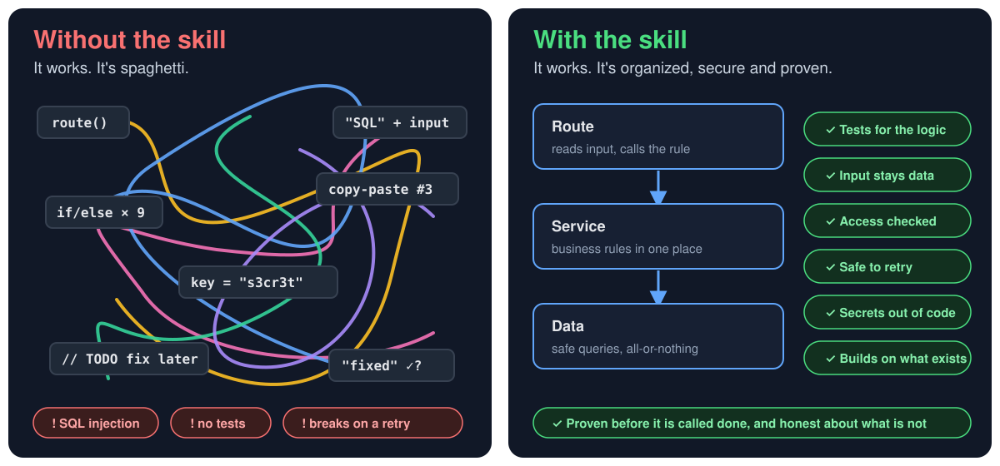

<div align="center">


# agent-skill-ultimate-coding

### Senior-engineer discipline for AI coding agents, in any language.

**Small, clear, safe code that is _proven_ before it is called done.**

[](https://github.com/Khodour/agent-skill-ultimate-coding/stargazers)
[](.claude-plugin/plugin.json)
[](LICENSE)
[](#install)
[](#proven-with-evals)
[](https://www.linkedin.com/in/kodr-fouani-b75523179/)

**[Why](#why-every-developer-needs-it) · [What it does](#what-it-does) · [Proof](#proven-with-evals) · [Install](#install) · [Contributing](#contributing)**

</div>


---

AI agents write code that **works**. Too often it is also **spaghetti**: it runs today, but the logic is tangled through the handlers, the input goes straight into the query, the same code is copied three times, nothing is tested, and the agent says "fixed" without proof.

This skill makes the agent work like a careful senior engineer, in any language, so the code it writes is **organized, secure, reliable and proven**.

<p align="center">
  
</p>

## Why every developer needs it

Code that only works is a debt you pay later: every change gets slower, bugs hide in the tangle, and one missed check becomes a security incident. AI agents already know the rules of good engineering. What they lack is **consistency**: under pressure they skip them. The skill brings that discipline to every task, big or small.

## What it does

| | Without the skill | With the skill |
|---|---|---|
| 🧱 **Organized** | Logic tangled into handlers, code copied | Clear layers, builds on what already exists |
| 🔒 **Secure** | Input glued into queries, secrets in code | Input stays data, access checked, secrets out |
| ♻️ **Reliable** | Breaks on a double click or a retry | Safe to repeat, never breaks what is shipped |
| 🧪 **Tested** | "Works on my run" | Tests for every piece of logic it adds |
| 🗣️ **Honest** | "Fixed!" without running anything | Proof, or a clear line on what was not checked |
| 🤝 **Asks first** | Guesses what you left open | Asks, with options and a recommendation |

It scales the effort to the task: a typo stays a one-line change, and a payment feature gets the full treatment. Your instructions and your project's own rules always come first.

## Proven with evals

Every case runs **with and without** the skill (three times on Sonnet and Haiku, once on Opus), on hard tasks only (cases the model already solves on its own are removed, because they prove nothing).

| Model | Without the skill | With the skill |
|---|:---:|:---:|
| Claude Sonnet 5.5 | 0.60 | ✅ **0.99** |
| Claude Haiku 5.5 | 0.54 | ✅ **0.88** |
| Claude Opus 5.5 | 0.63 | ✅ **0.97** |

2026-11-28, Sonnet judge: Sonnet and Haiku on all 33 cases (3 runs per arm), Opus on 33 (1 run per arm). Every case, every score and the few where the skill did not help are in [evals/RESULTS.md](evals/RESULTS.md). The extra care costs about twice the turns of an agent working without it.

## Install

**Claude Code (plugin):**

```
/plugin marketplace add Khodour/agent-skill-ultimate-coding
/plugin install agent-skill-ultimate-coding@agent-skill-ultimate-coding
```

The plugin loads the skill for every coding task and shows the agent's checklist above the input while it works (switch it off in `/config` if you prefer).

**Other agents:** copy the `skills/agent-skill-ultimate-coding/` folder into your agent's skills folder (for example `~/.agents/skills/` for Codex, Cursor, Gemini CLI and Copilot), and add this line to your project's `CLAUDE.md` or `AGENTS.md`:

```markdown
For every coding task, load the agent-skill-ultimate-coding skill first and follow it.
```

## Run the evals yourself

```bash
CLAUDE_CODE_ENABLE_TODO_TOOLS=1 claude plugin eval . --scaffold --no-publish \
  --model sonnet --judge-model sonnet --runs 3 \
  --allow-tools Edit Write ToolSearch TaskCreate TaskUpdate "Bash(python3 -m unittest:*)" "Bash(node --test:*)"
```

Some cases build a small sample project (`--scaffold`); read their `scaffold.sh` first. Without `--allow-tools` the agent cannot edit files or run tests, and every case fails.

## Contributing

Issues and pull requests are welcome. A new rule must come from a trusted source (OWASP, NIST, CWE, official vendor docs), work in any language, and come with an eval that fails without the skill.

## About the author

Built by **[Khodour](https://www.linkedin.com/in/kodr-fouani-b75523179/)**, an Anthropic-certified AI architect and senior software engineer with more than 25 years of experience shipping production software with large teams.

## License

[MIT](LICENSE). Free to use, modify and share, including for commercial use.
