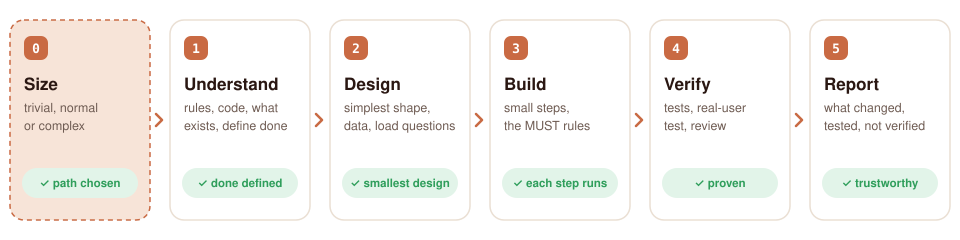

<div align="center">


# agent-skill-ultimate-coding

### Senior-engineer discipline for AI coding agents, in any language.

**Small, clear, safe code that is _proven_ before it is called done.**

[](https://github.com/Khodour/agent-skill-ultimate-coding/stargazers)
[](.claude-plugin/plugin.json)
[](LICENSE)
[](#install)
[](#proven-with-evals)
[](https://www.linkedin.com/in/kodr-fouani-b75523179/)

**[Install](#install) · [How it works](#how-it-works) · [The MUST rules](#the-must-rules) · [Evals](#proven-with-evals) · [Contributing](#contributing)**

</div>

---

AI coding agents already know the principles of good engineering. What they lack is consistency: they agree with the rules, then skip them under pressure. This skill builds that discipline into every task. The agent sizes the work, plans before it codes, checks each edit automatically, and proves the result before calling it done.

| ❌ Without the skill | ✅ With the skill |
|---|---|
| Reports "fixed" without running anything | Shows proof, or states clearly what was not verified |
| Weakens a test or a security check to make an error disappear | Fixes the root cause |
| Invents functions, API fields or packages | Verifies they exist in the installed version |
| Overlooks double submits, race conditions and retries | Writes safe, repeatable, backward-compatible changes |
| Over-engineers a one-line fix | Matches the effort to the size of the task |

## Proven with evals

Every task in the suite runs **with and without** the skill and is scored by an independent judge. The skill raises the average score on every Claude model:

| Model | Tests | Without the skill | With the skill |
|---|---|:---:|:---:|
| Claude Haiku 5.5 | Full suite | 0.82 | ✅ **0.96** |
| Claude Sonnet 5.5 | Full suite | 0.83 | ✅ **0.97** |
| Claude Opus 5.5 | 10 hardest tests | 0.68 | ✅ **0.97** |

<p align="center">
  
</p>

<p align="center">
  
</p>

The chart shows the behaviours the skill takes to 100%. Partial gains and the two small regressions are in the table below. On the remaining tasks, both versions perform well, and small fixes stay small. [Run the evals yourself](#evals).

<details>
<summary>The numbers behind the chart</summary>

Passing runs, without → with the skill. ✅ marks a behaviour that passed every run.

| Behaviour | Haiku 5.5 | Sonnet 5.5 | Opus 5.5 |
|---|:---:|:---:|:---:|
| Editing code with a query inside a loop fixes it | 0/3 → ✅ 3/3 | passed before | not run |
| Database rules are kept out of the web layer | 0/5 → 1/5 | 0/3 → ✅ 3/3 | 0/3 → ✅ 3/3 |
| A gift card's rules are kept apart and its balance is safe under races | 0/5 → ✅ 5/5 | 0/3 → ✅ 3/3 | 0/3 → ✅ 3/3 |
| A coupon's rules are kept apart and it is used once per customer | 0/5 → 1/5 | 0/3 → ✅ 3/3 | 0/3 → 2/3 |
| Order code is safe against double submits | 0/3 → ✅ 3/3 | 1/3 → ✅ 3/3 | 1/3 → ✅ 3/3 |
| A bill split adds up exactly to the total | 0/3 → 2/3 | 0/3 → ✅ 3/3 | passed before |
| A bug fix comes with a test that reproduces the bug | passed before | 0/3 → ✅ 3/3 | passed before |
| A bug fix finds the root cause | 0/3 → 2/3 | passed before | not run |
| A business rule is kept out of the route | 1/3 → ✅ 3/3 | passed before | not run |
| Queries built from user input stay parameterized | 2/3 → ✅ 3/3 | passed before | not run |
| Debug logs never write raw errors or request bodies | 0/5 → ✅ 5/5 | not run | not run |
| A public endpoint that sends paid email gets a rate limit in the code | 0/5 → ✅ 5/5 | not run | not run |
| A failed cart read never wipes the saved cart | 2/3 → 2/3 | 1/3 → ✅ 3/3 | passed before |
| An AI support bot needs a human to approve refunds | 1/3 → ✅ 3/3 | 2/3 → ✅ 3/3 | passed before |
| An AI summary is cached and survives a failed call | passed before | 1/3 → ✅ 3/3 | not run |
| A typo fix gets a short reply | passed before | 3/3 → 2/3 | passed before |
| A small change gets a short report | 3/3 → 0/3 | passed before | not run |

The last two rows are the only places where the skill scored lower: on small tasks its reply can run a little long.

</details>

## How it works

<p align="center">
  
</p>

| Size | Examples | What runs |
|---|---|---|
| 🟢 **Trivial** | Typo, text change, rename, one config value | The change and the project's checks |
| 🔵 **Small** | One self-contained function: a formatter, a parser, a pure calculation | A three-line design, tests by risk, a one-line confidence report |
| 🟡 **Normal** | Feature, bug fix, anything touching data, files or the network | A short design before code, tests by risk, a concise report |
| 🔴 **Complex** | Payments, auth, personal data, migrations, concurrency, public APIs | Everything above, plus an independent review and concurrency checks |

- **Lightweight.** The core stays short; detailed guidance loads only when a task needs it.
- **Automated checks.** A built-in checker scans every edit for common dangers, such as unsafe SQL, disabled security checks, hard-coded secrets and swallowed errors.
- **Respects your project.** Your instructions and your project's own rules always come first.
- **Low overhead.** A few thousand tokens per task.

## The MUST rules

Applied to every task, whatever its size. Only you can override one, and the agent will flag it in its report.

- 🔒 **Security:** data never becomes code · check access for every action **and every record** · never hand-roll auth or crypto · secrets stay out of code, git, logs and apps, and logs never hold personal data or raw errors · never weaken a safety check
- 💾 **Data:** all-or-nothing writes, safe to repeat · never delete or overwrite data without an explicit OK · never break what is shipped
- 🧾 **Honesty:** prove it, don't claim it · never weaken a test · never invent names, APIs or packages · fix the cause, not the symptom
- ⚠️ **Actions:** confirm before anything irreversible or touching production

## Install

**Claude Code (plugin):**

```
/plugin marketplace add Khodour/agent-skill-ultimate-coding
/plugin install agent-skill-ultimate-coding@agent-skill-ultimate-coding
```

**Other agents:** copy the `skills/agent-skill-ultimate-coding/` folder into your agent's skills folder (for example `~/.agents/skills/` for Codex, Cursor, Gemini CLI and Copilot). Tested on Claude Code; feedback from other agents is welcome.

### Make it always on (recommended)

The plugin loads the skill automatically. If you installed it manually, add this line to your project's `CLAUDE.md` or `AGENTS.md`:

```markdown
For every coding task, load the agent-skill-ultimate-coding skill first and follow it. Any task that adds or changes logic starts with its design card, written in your reply before any code.
```

## Evals

```bash
claude plugin eval . --no-publish --judge-model sonnet --max-cost-usd 10
```

Each case runs with and without the skill and reports the difference. Some cases build a sample project and need `--scaffold`; review their `scaffold.sh` before running them.

## Contributing

Issues and pull requests are welcome. A new rule should work in any language, prevent a real failure, and measurably change what the agent does.

## About the author

Built by **[Khodour](https://www.linkedin.com/in/kodr-fouani-b75523179/)**, an Anthropic-certified AI architect and senior software engineer with more than 25 years of experience shipping production software with large teams.

## In Claude Code

Extra on-screen help, each one switchable in `/config`: a status bar above the prompt (working, waiting for you, done or stopped, with checks and confidence), check-diff results under each edit, a `/uc-score` session scorecard, a design-card check before edits to money, auth, personal data, migrations, concurrency or public APIs, and a report check that asks Claude once to end a coding task with its report and confidence (skipped when your project's `CLAUDE.md` or `AGENTS.md` sets its own format, or when you ask for a different reply). Only the design-card and report checks cost tokens, and only when they step in.

## License

[MIT](LICENSE). Free to use, modify and share, including for commercial use.
