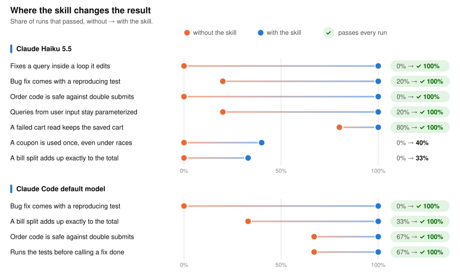

<div align="center">


# agent-skill-ultimate-coding

### Senior-engineer discipline for AI coding agents, in any language.

**Small, clear, safe code that is _proven_ before it is called done.**

[](https://github.com/Khodour/agent-skill-ultimate-coding/stargazers)
[](.claude-plugin/plugin.json)
[](LICENSE)
[](#install)
[](#proven-with-evals)
[](https://www.linkedin.com/in/kodr-fouani-b75523179/)

**[Install](#install) · [How it works](#how-it-works) · [The MUST rules](#the-must-rules) · [Evals](#proven-with-evals) · [Contributing](#contributing)**

</div>

---

Today's models already know SOLID, DRY and SQL injection. What they lack is **discipline**: they agree with the rules, then skip them. This skill ties the rules to the moments of a real task, makes the agent write a short design card before any code, checks every edit with a small script, and asks for proof before "done".

| ❌ The agent habit | ✅ With the skill |
|---|---|
| Says "fixed ✅" without running anything | Shows output that proves it, or says what wasn't verified |
| Weakens a test, or switches off SSL or CSRF, to make an error go away | Fixes the cause |
| Invents function names, API fields or packages | Checks they exist, in the version the project installs |
| Ignores double clicks, races, retries and old app versions | Transactions, safe-to-repeat actions, backward compatibility |
| Over-builds a one-word fix | Sizes the task first, so trivial work stays light |

## Proven with evals

Real tasks, run **with and without** the skill using Claude Code's `plugin eval` and graded by a separate judge. On a small, fast model (Claude Haiku 5.5) the average score across the whole suite rose from **0.77 to 0.94**, at the same cost per task as the previous version.

<p align="center">
  
</p>

The chart shows only where the skill changed the result. Everywhere else both arms passed (security basics, migrations, API compatibility, project layout, state changes, error handling, translations), and the skill didn't get in the way: trivial fixes stay short. *Held-out* cases were written after the skill was finished, and the skill is never changed to pass them. [Run them yourself](#evals).

<details>
<summary>The numbers behind the chart</summary>

| Behaviour | Default model | Claude Haiku 5.5 |
|---|:---:|:---:|
| A bug fix comes with a test that reproduces the bug | 0/3 → 3/3 | 1/5 → 5/5 |
| Editing a function with a query inside a loop fixes it | already passed | 0/5 → 5/5 |
| Order code is safe against double submits | 2/3 → 3/3 | 0/5 → 5/5 |
| A query built from user input stays parameterized | already passed | 1/5 → 5/5 |
| A bill split adds up exactly to the total | 1/3 → 3/3 | 0/3 → 1/3 |
| The agent runs the tests before calling a fix done | 2/3 → 3/3 | already passed |
| *Held out:* a coupon is used once per customer, even with two requests at once | not run | 0/5 → 2/5 |
| *Held out:* a failed cart read never wipes the saved cart | not run | 4/5 → 5/5 |

</details>

## How it works

<p align="center">
  
</p>

| Size | Examples | What runs |
|---|---|---|
| 🟢 **Trivial** | Typo, text, rename, one config value (no new logic) | The change, the project's checks, one short sentence |
| 🟡 **Normal** | Feature, bug fix, any new function | A design card before code, the five moments, tests by risk, a short report |
| 🔴 **Complex** | Money, auth, personal data, migrations, concurrency, public APIs | All of the above, plus the matching reference files, an independent review and concurrency checks |

- **`SKILL.md` stays short.** Detail lives in `references/` (design, structure, correctness, security, testing, existing code, performance, resilience, UI, review, worked examples), and the agent reads a file only when the task touches its topic.
- **A checker, not only rules.** `scripts/check-diff.sh` reads only the lines a change adds and flags known dangers with the fix: SQL built from strings, TLS checks turned off, secrets in code, swallowed errors, skipped tests, money in floats, a query inside a loop. It needs only bash and git, and as a Claude Code plugin it runs after every file edit.
- **Who wins when rules disagree:** your instruction → the project's own rules (`CLAUDE.md`, `AGENTS.md`) → a skill made for the project's framework → this skill.
- **Cost:** a few thousand tokens and one tool call per task.

## The MUST rules

Never skipped, at any task size. Only you can override one, and the agent warns and records it.

- 🔒 **Security:** data never becomes code · check access for every action **and every record** · never hand-roll auth or crypto · secrets stay out of code, git, logs and apps · never weaken a safety check
- 💾 **Data:** all-or-nothing writes, safe to repeat · never delete or overwrite data without an explicit OK · never break what is shipped
- 🧾 **Honesty:** prove it, don't claim it · never weaken a test · never invent names, APIs or packages · fix the cause, not the symptom
- ⚠️ **Actions:** confirm before anything irreversible or touching production

## Install

**Claude Code (plugin):**

```
/plugin marketplace add Khodour/agent-skill-ultimate-coding
/plugin install agent-skill-ultimate-coding@agent-skill-ultimate-coding
```

**Any agent:** copy `skills/agent-skill-ultimate-coding/` (with `references/` and `scripts/`) into your agent's skills folder, such as `~/.claude/skills/` for Claude Code, or `~/.agents/skills/` for Codex, Cursor, Gemini CLI and Copilot. Only Claude Code has been tested so far; reports from other agents are welcome.

### Make it always on (recommended)

The plugin loads the skill on every coding task by itself. If you copied the folder or use another agent, add this line to your project's `CLAUDE.md` or `AGENTS.md`:

```markdown
For every coding task, load the agent-skill-ultimate-coding skill first and follow it. Any task that adds or changes logic starts with its design card, written in your reply before any code.
```

## Evals

```bash
claude plugin eval . --no-publish --judge-model sonnet --max-cost-usd 10
```

Each case runs with and without the skill and reports the difference. Cases that build a real project (`repo-*`, `held-out-*`) also need `--scaffold` and `--allow-tools`; read their `scaffold.sh` first.

## Contributing

Issues, forks and pull requests are welcome. Every rule must be language-neutral, say what failure it prevents, and change what an agent does.

## About the author

Built by **[Khodour](https://www.linkedin.com/in/kodr-fouani-b75523179/)**, an Anthropic-certified AI architect and senior software engineer with 25+ years of shipping production software with large teams.

## License

[MIT](LICENSE): free to use, change, fork and share, including commercially.

## Star history

<a href="https://star-history.com/#Khodour/agent-skill-ultimate-coding&Date">
  
</a>
