<div align="center">


# agent-skill-ultimate-coding

### Senior-engineer discipline for AI coding agents, in any language.

**Small, clear, safe code that is _proven_ before it is called done.**

Light and powerful: a small core of about 4k tokens that pulls in detail only when the task needs it.

[](https://github.com/Khodour/agent-skill-ultimate-coding/stargazers)
[](.claude-plugin/plugin.json)
[](LICENSE)
[](#install)
[](#how-it-powers-up-the-agent)
[](https://www.linkedin.com/in/kodr-fouani-b75523179/)

**[Install](#install) · [What it solves](#what-it-solves) · [Proof](#how-it-powers-up-the-agent) · [Contributing](#contributing)**

<sub>Works in any language, including</sub><br>


</div>


---

## Install

**Claude Code (plugin):**

```
/plugin marketplace add Khodour/agent-skill-ultimate-coding
/plugin install agent-skill-ultimate-coding@agent-skill-ultimate-coding
```

The plugin loads the skill for every coding task and shows the agent's checklist above the input while it works (switch it off in `/config` if you prefer).

**Other agents:** copy the `skills/agent-skill-ultimate-coding/` folder into your agent's skills folder (for example `~/.agents/skills/` for Codex, Cursor, Gemini CLI and Copilot), and add this line to your project's `CLAUDE.md` or `AGENTS.md`:

```markdown
For every coding task, load the agent-skill-ultimate-coding skill first and follow it.
```

## What it solves

AI agents write code that **works**. Too often it is also **spaghetti**: tasty today, impossible to untangle tomorrow. Each picture is the same task: without the skill on the left, with it on the right.

### 🍝 A bowl of spaghetti → 🍕 a neatly sliced pizza

<p align="center"></p>

### 🗂️ "Where's checkout?" → planned first, sliced by feature

<p align="center"></p>

### 🔒 An open front door → a bouncer on every route

<p align="center"></p>

### ♻️ Double click, double trouble → click twice, sell once

<p align="center"></p>

### 🧪 "Fixed!" (it was not) → receipts, not vibes

<p align="center"></p>

### 🤝 Mind reading → asking first

<p align="center"></p>

### 🧭 Rewrites first → reads the room first

<p align="center"></p>

### ⚖️ A 9-step plan for a typo → a typo fix for a typo

<p align="center"></p>

Your instructions and your project's own rules always come first. The skill is the sous-chef, not the head chef.

## How it powers up the agent

Every case runs the same task **with and without** the skill, and graders check the result. Only hard cases are kept: a task the model already gets right on its own proves nothing, so it is removed. Grey is without the skill, green is with it.

<p align="center"></p>

<p align="center"></p>

<p align="center"></p>

2026-11-28, Sonnet judge, 33 cases: 3 runs per case on Sonnet and Haiku, 1 on Opus. "Right-sized" checks that the skill stays out of the way (questions, small tasks, non-coding requests), so the same score both ways is the goal. Every case, every score and the few where the skill did not help are in [evals/RESULTS.md](evals/RESULTS.md). The extra care costs about twice the turns of an agent working without it.

## Run the evals yourself

```bash
CLAUDE_CODE_ENABLE_TODO_TOOLS=1 claude plugin eval . --scaffold --no-publish \
  --model sonnet --judge-model sonnet --runs 3 \
  --allow-tools Edit Write ToolSearch TaskCreate TaskUpdate "Bash(python3 -m unittest:*)" "Bash(node --test:*)"
```

Some cases build a small sample project (`--scaffold`); read their `scaffold.sh` first. Without `--allow-tools` the agent cannot edit files or run tests, and every case fails.

## Contributing

Issues and pull requests are welcome. A new rule must come from a trusted source (OWASP, NIST, CWE, official vendor docs), work in any language, and come with an eval that fails without the skill.

## About the author

Built by **[Khodour](https://www.linkedin.com/in/kodr-fouani-b75523179/)**, an Anthropic-certified AI architect and senior software engineer with more than 25 years of experience shipping production software with large teams.

## License

[MIT](LICENSE). Free to use, modify and share, including for commercial use.
